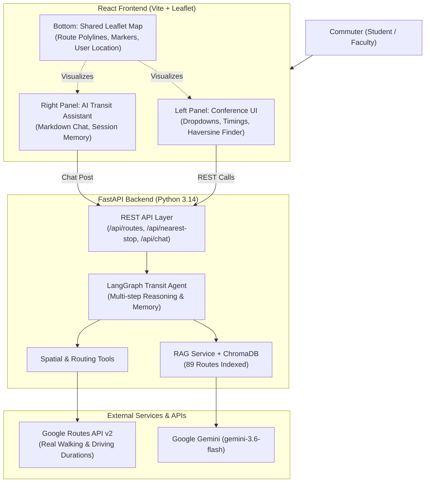

# 🚌 VIT-Ride — Intelligent Campus Transit AI

An AI-powered campus bus route recommendation and navigation system that extends the published ICCCNT 2024 conference paper (*"Optimized Bus Route Finder for Educational Institutes using Haversine formula"*).

The system addresses the core research question: **Is proximity-based stop recommendation suboptimal?** By combining Haversine spatial filtering, ChromaDB vector search, Google Gemini, and Google Routes API v2, the platform transitions campus transit from simple *"which stop is closest?"* to intelligent *"which bus gets me to campus fastest?"*.

---

## 🏛️ System Architecture



---

## ✨ Key Features

1. **Dual-Panel Interface**:
   - **Left Panel (Conference Baseline)**: Exact ICCCNT 2024 functionality — morning/afternoon time slot filtering, route stop tables, driver contact display, and coordinate-based Haversine nearest stop search.
   - **Right Panel (Journal AI Assistant)**: Plain-English conversational assistant capable of cross-route comparison, goal-directed arrival planning, and driver accountability queries.
   - **Shared Bottom Map**: OpenStreetMap Leaflet visualization tracking routes, stops, and user proximity circles.

2. **Empirical Grounding**:
   - Ingests verified institutional route data across 89 routes and 393 stops in the Chennai metropolitan area.
   - Automatically handles both AC and Non-AC buses, driver contacts, and faculty in-charges.

3. **Multi-Step Trip Optimization**:
   - Computes total journey time: $\text{Total} = \text{Walking Time to Stop} + \text{Bus Travel Time to Campus}$.
   - Proves empirically where Haversine straight-line distance picks a suboptimal stop due to road network winding and bus speeds.

---

## 🚀 Quickstart & Installation

### Prerequisites
- **Python 3.10+** (tested on 3.14)
- **Node.js 18+** & **npm 10+**
- Google Gemini API Key & Google Maps API Key

### 1. Configure Environment Variables
Copy the template and fill in your keys:
```bash
cp .env.example .env
```
In `.env`:
```env
GEMINI_API_KEY=your_actual_gemini_key
GOOGLE_MAPS_API_KEY=your_actual_google_maps_key
```

### 2. Backend Setup
```bash
# Install dependencies
pip install -r backend/requirements.txt

# Verify API keys
python backend/scripts/test_api_keys.py

# Run all backend endpoint tests
python backend/scripts/test_backend_endpoints.py

# Start FastAPI server (runs on http://localhost:8000)
uvicorn backend.app.main:app --reload --port 8000
```

### 3. Frontend Setup
```bash
cd frontend
npm install
npm run dev
```
Open **http://localhost:5173** in your browser.

---

## 📡 API Reference

| Method | Endpoint | Description | Sample Payload / Params |
|--------|----------|-------------|-------------------------|
| `GET` | `/health` | Server health check | — |
| `GET` | `/api/routes` | List all routes by time slot | `?time_slot=morning` |
| `GET` | `/api/routes/{route_no}` | Full stop list and contacts | `/api/routes/2` |
| `POST` | `/api/nearest-stop` | Haversine distance finder | `{"latitude": 13.0904, "longitude": 80.2158, "radius_km": 2.0}` |
| `GET` | `/api/route-names` | Dropdown route catalog | — |
| `POST` | `/api/chat` | AI Assistant query | `{"message": "Any bus from CMBT?", "session_id": "commuter1"}` |
| `DELETE` | `/api/chat/{session_id}` | Reset session history | `/api/chat/commuter1` |

---

## 🔬 Journal Evaluation Scripts

### 1. Empirical Ablation Study
Directly compares Haversine-only ($C_1$) vs. AI Agent Multi-Step Optimization ($C_3$) across 20 Chennai commuter origins:
```bash
python backend/scripts/ablation_study.py
```
*Outputs detailed metrics to `backend/scripts/ablation_results.csv` showing how often Haversine selects a slower route.*

### 2. RAG Precision & Latency Benchmark
Tests retrieval precision ($P@1, P@3, P@5$) and response latency across institutional test questions:
```bash
python backend/scripts/eval_rag.py
```
