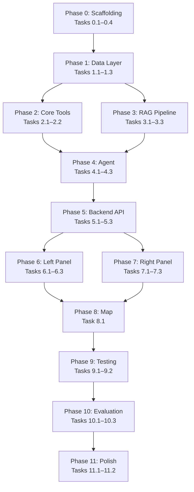

# 🚌 AI-Powered Campus Transit System — Master Task List (Final)

> **Source**: [Journal_Extension_Complete.pdf](file:///c:/Users/DELL/Desktop/Proctor%20Project/Journal_Extension_Complete.pdf)
>
> **Goal**: Build an intelligent campus bus route finder for VIT Chennai that extends the conference paper (ICCCNT 2024) by adding an AI chat assistant with RAG, Google Directions API, and multi-step trip planning.
>
> **Tech Stack**: React (frontend) · FastAPI (backend) · LangGraph (agent orchestration) · ChromaDB (vector store) · Google Gemini (LLM) · Google Directions API · Haversine formula

> [!IMPORTANT]
> Each task below is **self-contained** and designed so a lower-context model can execute it **without needing full project context**. Tasks are ordered by dependency — complete them top-to-bottom. Each task states its **inputs**, **outputs**, **files to create/modify**, and **acceptance criteria**.

---

## 📂 Existing Assets (Available in the project)

| Asset | Path | What It Contains |
|-------|------|------------------|
| **Route data (updated)** | `Past work/routeUpdated.xlsx` | 288 stops, 76 routes. Columns: `ROUTE_NO, ROUTE_NAME, TYPE (AC/NON AC), STOP_NAME, TIMING, LATITUDE, LONGITUDE` |
| **Route data (original)** | `Past work/routes.xlsx` | 492 stops, 79 routes. Columns: `ROUTE_NO, STOP_NAME, TIMING, LATITUDE, LONGITUDE` |
| **Haversine + FastAPI backend** | `Past work/BusRESTapi-main/app.py` | Working `haversine_distance()`, `calculateDist()`, geocoding endpoint, route data endpoints |
| **Gradio frontend** | `Past work/busRouteGradioApp-main/app.py` | Map visualization with Plotly, route filtering, nearest stop finder UI |
| **Conference paper** | `papers/C1_Optimized_Bus_Route_Finder_for_Educational_Institutes_using_Haversine_formula.pdf` | Published ICCCNT 2024 paper with system architecture, DB schema, UI screenshots |

**Key decisions made:**
- **Primary dataset**: `routeUpdated.xlsx` (has ROUTE_NAME and TYPE columns)
- **Time slots**: All existing data labeled as `"morning"`. Afternoon/evening to be added later.
- **Driver/in-charge contacts**: Generate dummy placeholder data for all 76 routes.
- **VIT Campus coordinates**: `12.840658, 80.153187` (confirmed from routes.xlsx, Route 1, "VIT" stop)

---

## Phase 0: Project Scaffolding & Environment Setup

### Task 0.1 — Initialize Project Directory Structure
- `[ ]` **What**: Create the folder structure for the entire project.
- **Create these directories and files**:
  ```
  c:\Users\DELL\Desktop\Proctor Project\
  ├── backend/
  │   ├── app/
  │   │   ├── __init__.py          (empty)
  │   │   ├── main.py              (FastAPI entry point — Task 0.4)
  │   │   ├── config.py            (settings — Task 0.2)
  │   │   ├── models/
  │   │   │   └── __init__.py      (empty)
  │   │   ├── routers/
  │   │   │   └── __init__.py      (empty)
  │   │   ├── services/
  │   │   │   └── __init__.py      (empty)
  │   │   ├── tools/
  │   │   │   └── __init__.py      (empty)
  │   │   └── data/
  │   │       └── routes/          (JSON route data — Task 1.2)
  │   ├── scripts/                 (evaluation scripts — Phase 10)
  │   └── requirements.txt         (Task 0.2)
  ├── frontend/                    (React app — Task 0.3)
  └── .env.example                 (Task 0.2)
  ```
- **Do NOT delete or move** the `Past work/`, `papers/`, or any existing files.
- **Acceptance**: All directories and empty `__init__.py` files exist.

---

### Task 0.2 — Backend Dependencies & Configuration
- `[ ]` **What**: Create `requirements.txt` and `config.py` for the FastAPI backend.
- **Depends on**: Task 0.1
- **File**: `backend/requirements.txt`
  ```
  fastapi>=0.110.0
  uvicorn>=0.29.0
  pydantic>=2.0
  pydantic-settings>=2.0
  python-dotenv>=1.0
  langchain>=0.2.0
  langchain-google-genai>=1.0
  langgraph>=0.1.0
  chromadb>=0.5.0
  google-generativeai>=0.5.0
  googlemaps>=4.10
  httpx>=0.27
  python-multipart>=0.0.9
  pandas>=2.0
  openpyxl>=3.1
  ```
- **File**: `backend/app/config.py`
  ```python
  from pydantic_settings import BaseSettings

  class Settings(BaseSettings):
      GEMINI_API_KEY: str = ""
      GOOGLE_MAPS_API_KEY: str = ""
      CHROMA_PERSIST_DIR: str = "./chroma_db"
      CORS_ORIGINS: list[str] = ["http://localhost:3000", "http://localhost:5173"]
      VIT_CAMPUS_LAT: float = 12.840658
      VIT_CAMPUS_LON: float = 80.153187

      class Config:
          env_file = ".env"
  ```
- **File**: `.env.example` (at project root)
  ```
  GEMINI_API_KEY=your-gemini-api-key-here
  GOOGLE_MAPS_API_KEY=your-google-maps-api-key-here
  ```
- **Acceptance**: `pip install -r backend/requirements.txt` succeeds. `from app.config import Settings` works.

---

### Task 0.3 — Initialize React Frontend
- `[ ]` **What**: Create a React app inside `frontend/` using Vite.
- **Depends on**: Task 0.1
- **Commands** (run from project root `c:\Users\DELL\Desktop\Proctor Project`):
  ```bash
  npm create vite@latest frontend -- --template react
  cd frontend
  npm install
  npm install axios leaflet react-leaflet react-markdown @mui/material @emotion/react @emotion/styled
  ```
- **Acceptance**: `npm run dev` inside `frontend/` starts at `http://localhost:5173`.

---

### Task 0.4 — FastAPI Skeleton with CORS
- `[ ]` **What**: Set up the FastAPI app entry point with CORS middleware and a health-check endpoint.
- **Depends on**: Task 0.2
- **File**: `backend/app/main.py`
  ```python
  from fastapi import FastAPI
  from fastapi.middleware.cors import CORSMiddleware
  from app.config import Settings

  settings = Settings()
  app = FastAPI(title="VIT Campus Transit AI", version="1.0.0")

  app.add_middleware(
      CORSMiddleware,
      allow_origins=settings.CORS_ORIGINS,
      allow_credentials=True,
      allow_methods=["*"],
      allow_headers=["*"],
  )

  @app.get("/health")
  def health():
      return {"status": "ok"}
  ```
- **Acceptance**: `uvicorn app.main:app --reload` from `backend/` → `GET /health` returns `{"status": "ok"}`.

---

## Phase 1: Data Layer — Route Data Preparation

### Task 1.1 — Define Route Data Schema (Pydantic Models)
- `[ ]` **What**: Create Pydantic models matching the route data structure.
- **Depends on**: Task 0.2
- **File**: `backend/app/models/route.py`
- **Models**:
  ```python
  from pydantic import BaseModel

  class Stop(BaseModel):
      name: str           # e.g. "PADI SARAVANA STORES"
      latitude: float     # e.g. 13.101010
      longitude: float    # e.g. 80.190161
      timing: str         # e.g. "6:15 AM" (normalized to 12hr format)

  class RouteInfo(BaseModel):
      route_number: str           # e.g. "1", "1A", "AF4" (string because of alphanumeric routes)
      route_name: str             # e.g. "PADI SARAVANA"
      time_slot: str              # "morning" (all current data is morning)
      bus_type: str               # "AC" or "NON AC"
      driver_name: str            # placeholder data
      driver_phone: str           # placeholder data
      incharge_name: str          # placeholder data
      incharge_phone: str         # placeholder data
      stops: list[Stop]

  class AllRoutes(BaseModel):
      routes: list[RouteInfo]
  ```
- **Note**: `route_number` is `str` not `int` because routes like "1A", "AF4" exist.
- **Acceptance**: `RouteInfo(route_number="1A", route_name="THIRUMANGALAM", ...)` instantiates without error.

---

### Task 1.2 — Convert Excel Data to JSON + Generate Dummy Contacts
- `[ ]` **What**: Read `Past work/routeUpdated.xlsx`, generate dummy driver/in-charge contacts, and save as JSON.
- **Depends on**: Task 1.1
- **Input file**: `c:\Users\DELL\Desktop\Proctor Project\Past work\routeUpdated.xlsx`
  - Columns: `ROUTE_NO, ROUTE_NAME, TYPE, STOP_NAME, TIMING, LATITUDE, LONGITUDE`
  - 288 rows, 76 unique routes
  - TYPE values: "AC" (54 rows) or "NON AC" (234 rows)
  - TIMING format is inconsistent: "6.15 AM", "06.30AM", "6:15 AM" — **normalize all to "H:MM AM/PM"**
- **Output file**: `backend/app/data/routes/all_routes.json`
- **Script to create** (one-time use): `backend/scripts/convert_excel_to_json.py`
- **Logic**:
  1. Read the Excel file with pandas.
  2. Group rows by `ROUTE_NO`.
  3. For each route, collect stops in order.
  4. Normalize timing strings: replace `.` with `:`, ensure space before AM/PM, consistent format.
  5. Generate dummy driver/in-charge data per route:
     - Driver names: use Indian names like "Rajesh Kumar", "Suresh Babu", "Mohan Raj", etc. Pick from a list.
     - Driver phones: generate like "+91-9XXXXXXXXX" with random digits.
     - In-charge names: use names like "Dr. Suresh", "Prof. Ramesh", etc.
     - In-charge phones: similar format.
  6. Set `time_slot: "morning"` for all routes.
  7. Save as JSON matching the `AllRoutes` schema.
- **Acceptance**: `all_routes.json` exists, is valid JSON, contains 76 routes, each with stops array. Timings are consistently formatted.

---

### Task 1.3 — Route Data Loader Service
- `[ ]` **What**: Create a service that loads route data from JSON and provides lookup methods.
- **Depends on**: Task 1.1, Task 1.2
- **File**: `backend/app/services/route_service.py`
- **Reference**: Reuse patterns from `Past work/BusRESTapi-main/app.py` ([lines 64–81](file:///c:/Users/DELL/Desktop/Proctor%20Project/Past%20work/BusRESTapi-main/app.py#L64-L81)) for route data retrieval logic.
- **Class/Functions**:
  ```python
  import json
  from pathlib import Path
  from app.models.route import RouteInfo, AllRoutes

  DATA_PATH = Path(__file__).parent.parent / "data" / "routes" / "all_routes.json"

  def load_routes() -> list[RouteInfo]:
      """Load all routes from the JSON data file."""
      with open(DATA_PATH, "r") as f:
          data = json.load(f)
      return AllRoutes(**data).routes

  def get_routes_by_time_slot(routes: list[RouteInfo], slot: str) -> list[RouteInfo]:
      """Filter routes by time_slot ('morning', 'afternoon', 'evening')."""
      return [r for r in routes if r.time_slot == slot]

  def get_route_by_number(routes: list[RouteInfo], route_num: str) -> RouteInfo | None:
      """Find a route by its route_number (string match, e.g. '1A')."""
      for r in routes:
          if r.route_number == route_num:
              return r
      return None

  def get_all_stop_names(routes: list[RouteInfo]) -> list[str]:
      """Return a flat list of all unique stop names."""
      names = set()
      for r in routes:
          for s in r.stops:
              names.add(s.name)
      return sorted(names)

  def search_stops_by_area(routes: list[RouteInfo], area_name: str) -> list[dict]:
      """Case-insensitive substring match on stop names.
      Returns list of {route_number, route_name, stop_name, timing, time_slot}."""
      area_lower = area_name.lower()
      results = []
      for r in routes:
          for s in r.stops:
              if area_lower in s.name.lower():
                  results.append({
                      "route_number": r.route_number,
                      "route_name": r.route_name,
                      "stop_name": s.name,
                      "timing": s.timing,
                      "time_slot": r.time_slot,
                  })
      return results
  ```
- **Acceptance**: `load_routes()` returns 76 `RouteInfo` objects. `search_stops_by_area("CHROMEPET")` returns matching stops.

---

## Phase 2: Core Tools (Haversine, Directions API)

### Task 2.1 — Haversine Distance Tool
- `[ ]` **What**: Implement the Haversine formula to find nearby bus stops given user coordinates.
- **Depends on**: Task 1.1
- **File**: `backend/app/tools/haversine.py`
- **Reference**: Reuse the working implementation from `Past work/BusRESTapi-main/app.py` ([lines 20–39](file:///c:/Users/DELL/Desktop/Proctor%20Project/Past%20work/BusRESTapi-main/app.py#L20-L39)). Adapt it to use `RouteInfo` models instead of CSV rows.
- **Functions**:
  ```python
  import math
  from app.models.route import RouteInfo

  def haversine_distance(lat1: float, lon1: float, lat2: float, lon2: float) -> float:
      """Returns distance in kilometers between two lat/lon points.
      Uses Earth radius = 6371 km.
      Copy the formula from Past work/BusRESTapi-main/app.py lines 20-39."""
      lat1_rad, lon1_rad = math.radians(lat1), math.radians(lon1)
      lat2_rad, lon2_rad = math.radians(lat2), math.radians(lon2)
      delta_lat = lat2_rad - lat1_rad
      delta_lon = lon2_rad - lon1_rad
      a = math.sin(delta_lat / 2) ** 2 + math.cos(lat1_rad) * math.cos(lat2_rad) * math.sin(delta_lon / 2) ** 2
      c = 2 * math.atan2(math.sqrt(a), math.sqrt(1 - a))
      return 6371.0 * c

  def find_nearby_stops(
      user_lat: float,
      user_lon: float,
      routes: list[RouteInfo],
      radius_km: float = 2.0
  ) -> list[dict]:
      """
      Returns all stops within radius_km of user's location.
      Each result: {route_number, route_name, stop_name, distance_km, timing, time_slot, latitude, longitude}
      Sorted by distance_km ascending.
      """
  ```
- **Acceptance**: `haversine_distance(13.090476, 80.215826, 13.084926, 80.213364)` ≈ 0.67 km (matches Table II from the paper). `find_nearby_stops` returns sorted results.

---

### Task 2.2 — Google Directions API Integration
- `[ ]` **What**: Create a wrapper for the Google Directions API to compute real travel times.
- **Depends on**: Task 0.2 (for API key config)
- **File**: `backend/app/tools/directions.py`
- **Reference**: `Past work/BusRESTapi-main/app.py` ([lines 18, 109–128](file:///c:/Users/DELL/Desktop/Proctor%20Project/Past%20work/BusRESTapi-main/app.py#L18)) already uses `googlemaps` library. Extend for travel time computation.
- **Constants**: `VIT_CAMPUS_LAT = 12.840658`, `VIT_CAMPUS_LON = 80.153187`
- **Functions**:
  ```python
  import googlemaps

  VIT_CAMPUS_LAT = 12.840658
  VIT_CAMPUS_LON = 80.153187

  def get_travel_time(
      origin_lat: float, origin_lon: float,
      dest_lat: float, dest_lon: float,
      mode: str = "walking",  # "walking" | "driving" | "transit"
      api_key: str = None
  ) -> dict | None:
      """
      Returns: {"duration_minutes": float, "distance_km": float,
                "duration_text": str, "distance_text": str}
      Returns None if API call fails.
      """

  def compute_trip_plan(
      user_lat: float, user_lon: float,
      stop_lat: float, stop_lon: float,
      stop_departure_time: str,
      api_key: str = None
  ) -> dict:
      """
      Computes total trip: walk to stop + bus ride to campus.
      Uses 'walking' for user→stop and 'driving' for stop→campus (bus approximation).
      Returns: {"walk_to_stop_minutes": float, "bus_travel_minutes": float,
                "total_trip_minutes": float, "stop_departure": str}
      """
  ```
- **Acceptance**: With a valid API key, `get_travel_time` returns a dict with `duration_minutes`. Returns `None` on failure.

---

## Phase 3: RAG Pipeline (ChromaDB + Gemini)

### Task 3.1 — Convert Route Data to RAG Documents
- `[ ]` **What**: Create a function that converts structured route data into natural-language text chunks for embedding.
- **Depends on**: Task 1.1
- **File**: `backend/app/services/rag_indexer.py`
- **Logic**: For each route, generate a text document like:
  ```
  Route 1: PADI SARAVANA
  Type: AC
  Time Slot: Morning
  Driver: Rajesh Kumar, Phone: +91-9876543210
  In-Charge: Dr. Suresh, Phone: +91-9876543211
  Stops:
  1. PADI SARAVANA STORES (13.101010, 80.190161) - Departs 6:15 AM
  2. KORATTUR CHURCH (13.108180, 80.183417) - Departs 6:20 AM
  3. MANIKANDAPURAM BUS STAND (13.128681, 80.136927) - Departs 6:30 AM
  ...
  ```
  Each route = ONE document chunk. Metadata: `{route_number, time_slot, route_name, bus_type}`.
- **Function**:
  ```python
  def generate_route_documents(routes: list[RouteInfo]) -> list[dict]:
      """Returns list of {"id": str, "text": str, "metadata": dict}."""
  ```
- **Acceptance**: Given 76 routes, returns 76 document dicts. Each has non-empty text and a unique ID like `"route_1_morning"`.

---

### Task 3.2 — ChromaDB Vector Store Setup
- `[ ]` **What**: Create a service class that manages ChromaDB for indexing and searching route documents.
- **Depends on**: Task 3.1
- **File**: `backend/app/services/vector_store.py`
- **Class**:
  ```python
  import chromadb
  from app.models.route import RouteInfo
  from app.services.rag_indexer import generate_route_documents

  class RouteVectorStore:
      def __init__(self, persist_dir: str = "./chroma_db"):
          """Initialize ChromaDB persistent client. Create or get collection 'routes'."""

      def index_routes(self, routes: list[RouteInfo]) -> int:
          """Convert routes to documents, embed, store. Return count indexed."""

      def search(self, query: str, n_results: int = 5) -> list[dict]:
          """Semantic similarity search. Returns list of {text, metadata, distance}."""

      def clear(self):
          """Delete collection and recreate empty."""
  ```
- **Acceptance**: Index 76 routes → search "bus from VADAPALANI" → returns relevant route as top result.

---

### Task 3.3 — RAG Query Service (Retrieval + Gemini Generation)
- `[ ]` **What**: Create a service that retrieves relevant documents from ChromaDB and generates a grounded response using Google Gemini.
- **Depends on**: Task 3.2, Task 0.2
- **File**: `backend/app/services/rag_service.py`
- **Function**:
  ```python
  import google.generativeai as genai

  async def rag_query(
      user_query: str,
      vector_store: RouteVectorStore,
      gemini_api_key: str,
      chat_history: list[dict] = None
  ) -> str:
      """
      1. Search ChromaDB for top 5 relevant route documents.
      2. Build prompt with retrieved context + chat history + user query.
      3. Call Gemini to generate grounded answer.
      4. Return response text.
      """
  ```
- **System prompt** (embed in function):
  ```
  You are the VIT Chennai Campus Bus Assistant. Answer questions ONLY using the
  provided route data below. If the data does not contain the answer, say so.
  Always include route numbers, stop names, and timings in your answers.
  When comparing routes, present results in a clear table or list format.
  ```
- **Acceptance**: Query "Any bus from CMBT?" → response mentions Route 2 (CMBT route). Query "Who drives Route 1?" → returns the dummy driver name.

---

## Phase 4: AI Agent with LangGraph

### Task 4.1 — Define LangChain Tool Wrappers
- `[ ]` **What**: Wrap Haversine, Directions API, and RAG search into LangChain `@tool`-decorated functions.
- **Depends on**: Task 2.1, Task 2.2, Task 3.2, Task 1.3
- **File**: `backend/app/tools/agent_tools.py`
- **Tools** (each returns a formatted string):
  ```python
  from langchain_core.tools import tool

  @tool
  def find_nearby_stops_tool(user_lat: float, user_lon: float, radius_km: float = 2.0) -> str:
      """Find bus stops within a given radius of user coordinates."""

  @tool
  def get_travel_time_tool(origin_lat: float, origin_lon: float,
                           dest_lat: float, dest_lon: float, mode: str = "walking") -> str:
      """Get real travel time between two locations using Google Directions API."""

  @tool
  def search_routes_tool(query: str) -> str:
      """Search the bus route database using natural language. Use for questions
      about routes, stops, timings, drivers, schedules."""

  @tool
  def get_route_details_tool(route_number: str) -> str:
      """Get complete details of a specific bus route by number (e.g. '1', '1A')."""

  @tool
  def plan_trip_tool(user_lat: float, user_lon: float, target_arrival_time: str = "") -> str:
      """Plan a complete trip to VIT Chennai campus. Finds nearby stops, computes
      walk + bus travel time, and recommends the fastest option."""
  ```
- **Note**: Tools access route data, vector store, and API keys via module-level variables set during app startup.
- **Acceptance**: Each tool returns a formatted string when called with valid inputs.

---

### Task 4.2 — LangGraph Agent Graph Construction
- `[ ]` **What**: Build a LangGraph `StateGraph` that connects Gemini to the tools for multi-step reasoning.
- **Depends on**: Task 4.1
- **File**: `backend/app/services/agent.py`
- **Class**:
  ```python
  from langgraph.graph import StateGraph, MessagesState, END
  from langgraph.prebuilt import ToolNode
  from langchain_google_genai import ChatGoogleGenerativeAI

  class TransitAgent:
      def __init__(self, gemini_api_key: str, google_maps_api_key: str, vector_store):
          # 1. Create Gemini LLM (ChatGoogleGenerativeAI, model="gemini-1.5-flash")
          # 2. Bind tools to LLM
          # 3. Build StateGraph: "agent" node → conditional → "tools" node → loop back
          # 4. Compile graph
          # 5. Session history dict: {session_id: [messages]}

      async def chat(self, message: str, session_id: str = "default") -> str:
          # Process message through the agent graph with session history
  ```
- **System message**:
  ```
  You are the VIT Chennai Campus Bus AI Assistant. Help students find the best bus routes.
  You have tools to: search routes, find nearby stops, compute travel times, and plan trips.
  Always use your tools to get accurate data. Never make up route information.
  When recommending a bus, explain your reasoning.
  ```
- **Acceptance**: Agent answers "Any bus from CMBT?" using search tool. Agent answers "I'm at 13.05, 80.21. What bus?" using Haversine tool.

---

### Task 4.3 — Conversation Memory Manager
- `[ ]` **What**: Create an in-memory conversation history store keyed by session ID.
- **Depends on**: None (standalone utility)
- **File**: `backend/app/services/memory.py`
- **Class**:
  ```python
  class ConversationMemory:
      def __init__(self, max_history: int = 20):
          self._store: dict[str, list[dict]] = {}

      def add_message(self, session_id: str, role: str, content: str):
          """Add a message. role = 'user' | 'assistant'. Trim if over max_history."""

      def get_history(self, session_id: str) -> list[dict]:
          """Returns list of {"role": str, "content": str}."""

      def clear(self, session_id: str):
          """Clear all history for a session."""
  ```
- **Acceptance**: Add 3 messages → get 3 back. Add 21 (max=20) → oldest dropped. Clear empties it.

---

## Phase 5: Backend API Endpoints

### Task 5.1 — Route API Endpoints (Left Panel Data)
- `[ ]` **What**: Create REST endpoints that serve route data for the original interface.
- **Depends on**: Task 1.3, Task 2.1, Task 0.4
- **File**: `backend/app/routers/routes.py`
- **Endpoints**:
  | Method | Path | Params/Body | Returns |
  |--------|------|-------------|---------|
  | `GET` | `/api/routes` | `?time_slot=morning` | List of routes for that time slot |
  | `GET` | `/api/routes/{route_number}` | — | Full route details (stops, driver, in-charge) |
  | `POST` | `/api/nearest-stop` | `{"latitude": float, "longitude": float, "radius_km": float}` | Nearby stops sorted by distance |
  | `GET` | `/api/route-names` | — | List of unique route numbers + names |
- **Register** in `main.py`: `app.include_router(routes_router)`
- **Acceptance**: `GET /api/routes?time_slot=morning` returns 76 routes. `GET /api/route-names` returns 76 entries.

---

### Task 5.2 — Chat API Endpoint (Right Panel AI)
- `[ ]` **What**: Create the chat endpoint for the AI assistant.
- **Depends on**: Task 4.2, Task 4.3, Task 0.4
- **File**: `backend/app/routers/chat.py`
- **Endpoints**:
  | Method | Path | Body | Returns |
  |--------|------|------|---------|
  | `POST` | `/api/chat` | `{"message": str, "session_id": str}` | `{"response": str, "session_id": str}` |
  | `DELETE` | `/api/chat/{session_id}` | — | `{"status": "cleared"}` |
- **Acceptance**: Chat returns AI-generated responses. Follow-ups in same session use context.

---

### Task 5.3 — App Startup Initialization
- `[ ]` **What**: On FastAPI startup, load route data, index into ChromaDB, and initialize the agent.
- **Depends on**: Task 5.1, Task 5.2, Task 3.2, Task 4.2
- **File**: Modify `backend/app/main.py`
- **Add lifespan**:
  ```python
  from contextlib import asynccontextmanager

  @asynccontextmanager
  async def lifespan(app: FastAPI):
      # 1. Load routes from JSON → app.state.routes
      # 2. Init RouteVectorStore → index routes → app.state.vector_store
      # 3. Init TransitAgent → app.state.agent
      # 4. Log: "✅ Loaded {n} routes, indexed {n} documents, agent ready"
      yield

  app = FastAPI(title="VIT Campus Transit AI", version="1.0.0", lifespan=lifespan)
  ```
- **Acceptance**: Server starts with confirmation log. Chat endpoint works immediately.

---

## Phase 6: Frontend — Left Panel (Original Interface)

### Task 6.1 — Two-Panel App Layout
- `[ ]` **What**: Create the main App layout with left panel, right panel, and bottom map.
- **Depends on**: Task 0.3
- **File**: `frontend/src/App.jsx` and `frontend/src/App.css`
- **Layout**:
  ```
  ┌──────────────────┬──────────────────┐
  │   LeftPanel      │   ChatPanel      │
  │   (50% width)    │   (50% width)    │
  │   scroll: auto   │   scroll: auto   │
  │   max-h: 60vh    │   max-h: 60vh    │
  ├──────────────────┴──────────────────┤
  │          MapView (Leaflet)          │
  │          height: 350px              │
  └─────────────────────────────────────┘
  ```
- **Create placeholder components**: `LeftPanel.jsx`, `ChatPanel.jsx`, `MapView.jsx`.
- **Create API utility**: `frontend/src/api.js` with Axios baseURL `http://localhost:8000`.
- **Acceptance**: Two panels side-by-side on desktop. Stacks vertically on mobile (< 800px).

---

### Task 6.2 — Left Panel: Route Selector, Stops Table, Contacts
- `[ ]` **What**: Build the original conference paper interface.
- **Depends on**: Task 6.1, Task 5.1
- **File**: `frontend/src/components/LeftPanel.jsx`
- **UI elements**:
  1. **Title**: "VIT Chennai Bus Route Finder"
  2. **Time slot selector**: 3 radio buttons (Morning / Afternoon / Evening)
  3. **Route dropdown**: fetches from `GET /api/routes?time_slot=...`
  4. **Search button**: fetches `GET /api/routes/{route_number}`
  5. **Stops table**: `#, Stop Name, Timing`
  6. **Contacts**: Driver name + phone, In-charge name + phone
- **Acceptance**: Select Morning → dropdown fills → Search → stops table + contacts shown.

---

### Task 6.3 — Left Panel: Nearest Stop Finder
- `[ ]` **What**: Add coordinate inputs and "Find Nearest Stop" button.
- **Depends on**: Task 6.2
- **File**: Modify `frontend/src/components/LeftPanel.jsx`
- **UI**: Latitude input, Longitude input, Radius input (default 2 km), "Find Nearest Stop" button, Results table.
- **Calls**: `POST /api/nearest-stop`
- **Acceptance**: Enter `13.090476, 80.215826` → see SHANTI COLONY (Route 2) in results.

---

## Phase 7: Frontend — Right Panel (AI Chat)

### Task 7.1 — Chat Panel UI
- `[ ]` **What**: Build the conversational chat interface.
- **Depends on**: Task 6.1, Task 5.2
- **File**: `frontend/src/components/ChatPanel.jsx`
- **UI**: Header ("AI Bus Assistant 🤖" + "New Chat"), scrollable messages, text input + Send, loading indicator.
- **Messages**: User = right-aligned blue bubble. Assistant = left-aligned gray bubble rendered as Markdown (use `react-markdown`).
- **Session**: Generate UUID via `crypto.randomUUID()` on mount / new chat.
- **Acceptance**: Send message → user bubble → loading → assistant bubble. "New Chat" clears and resets session.

---

### Task 7.2 — Markdown Rendering for Chat
- `[ ]` **What**: Render assistant messages as Markdown.
- **Depends on**: Task 7.1
- **File**: Modify `ChatPanel.jsx`
- **Use**: `react-markdown` library. Tables, bold, bullet lists should render properly.
- **Acceptance**: A response with a Markdown table renders as HTML table.

---

### Task 7.3 — Session ID Management
- `[ ]` **What**: Ensure unique session IDs and proper cleanup.
- **Depends on**: Task 7.1
- **Logic**: `crypto.randomUUID()` on mount. Pass with every `/api/chat`. On "New Chat": `DELETE /api/chat/{old}`, generate new UUID.
- **Acceptance**: Two sessions don't share context. New chat loses previous context.

---

## Phase 8: Shared Map

### Task 8.1 — Leaflet Map Component
- `[ ]` **What**: Add a Leaflet map showing bus stops, routes, and user location.
- **Depends on**: Task 6.1
- **File**: `frontend/src/components/MapView.jsx`
- **Features**:
  1. Default center: VIT Chennai (`12.840658, 80.153187`), zoom 11
  2. VIT campus marker (red/star)
  3. Route stops as blue markers with popups (when route selected in LeftPanel)
  4. Polyline connecting stops in order
  5. User location as green marker (when coordinates entered)
  6. Nearby stops as orange markers
- **Props**: `selectedRoute`, `userLocation`, `nearbyStops`
- **Import**: `leaflet/dist/leaflet.css` in main entry
- **Acceptance**: Map renders. Selecting a route shows stops. Entering coords shows user marker.

---

## Phase 9: Integration & Testing

### Task 9.1 — End-to-End Test Checklist
- `[ ]` **What**: Verify the full system with these 8 test cases.
- **Prerequisites**: Backend + Frontend running, API keys in `.env`.
- **Test Cases**:
  | # | Scenario | Expected |
  |---|----------|----------|
  | 1 | Left panel: Morning → Route 1 → Search | Stops table with PADI SARAVANA STORES etc. + driver info |
  | 2 | Nearest stop: `13.090476, 80.215826` | SHANTI COLONY stop ≈ 0.67 km (matches paper Table II) |
  | 3 | Chat: "Any bus from CMBT?" | Response mentioning Route 2 |
  | 4 | Chat: "Which route goes through both VADAPALANI and CMBT?" | Cross-route answer |
  | 5 | Chat: "I need to reach campus by 9 AM. I am near Vadapalani." | Trip planning response |
  | 6 | Chat follow-up: "What if I leave 20 minutes later?" | Maintains context |
  | 7 | Chat: "Who drives Route 1?" | Dummy driver name + phone |
  | 8 | Map: Select Route 1 | Stops appear on map with polyline |

---

### Task 9.2 — Error Handling
- `[ ]` **What**: Add error handling across backend and frontend.
- **Backend**: API failures → fallback messages. Invalid input → 400. Gemini errors → 503.
- **Frontend**: Error toasts. Disabled send while loading. Empty state messages.
- **Acceptance**: Bad API key → graceful error, no crash.

---

## Phase 10: Evaluation & Ablation Infrastructure

### Task 10.1 — Ablation Study Script
- `[ ]` **What**: Script running 4 ablation configs across test locations.
- **File**: `backend/scripts/ablation_study.py`
- **Configs**: C1 (Haversine only), C2 (Haversine + Directions API), C3 (Full agent + RAG), C4 (Agent + follow-ups)
- **Input**: 20–30 test locations across Chennai (generate standard ones: Tambaram, Guindy, Velachery, Central, T. Nagar, etc.)
- **Output**: CSV with per-location results for each config.

---

### Task 10.2 — RAG Retrieval Accuracy Evaluation
- `[ ]` **What**: Evaluate RAG precision with 20 test queries.
- **File**: `backend/scripts/eval_rag.py`
- **Output**: Precision@1/3/5 scores + latency per query.

---

### Task 10.3 — Response Latency Instrumentation
- `[ ]` **What**: Add `response_time_ms` to chat API responses.
- **File**: Modify `backend/app/routers/chat.py`
- **Acceptance**: Every chat response includes timing.

---

## Phase 11: Polish & Deployment

### Task 11.1 — UI Styling & Theming
- `[ ]` **What**: Professional VIT blue/white theme. Material UI. Responsive.
- **Files**: `App.css`, component styles
- **Acceptance**: Looks professional on desktop and mobile.

---

### Task 11.2 — README & Setup Documentation
- `[ ]` **What**: Comprehensive README with setup instructions, API docs, architecture.
- **File**: `README.md` at project root
- **Acceptance**: New developer can clone + follow README + run the system.

---

## Execution Order



> [!TIP]
> **For lower-context models**: Hand each task individually with only (1) the task description, (2) the specific files it depends on, and (3) any existing files it modifies. No full project context needed.
